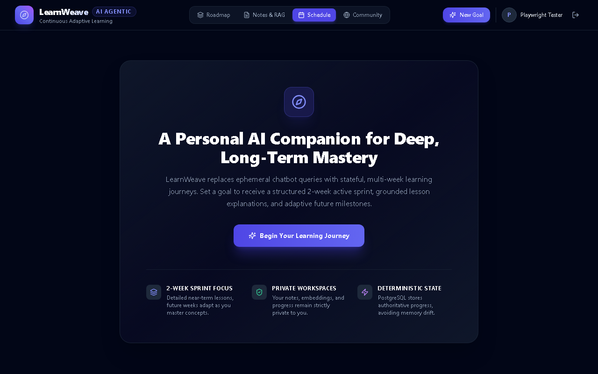

# LearnWeave AI — Agentic Personalized Learning Platform

[](https://www.python.org/)
[](https://fastapi.tiangolo.com/)
[](https://react.dev/)
[](https://github.com/pgvector/pgvector)
[](https://groq.com/)
[](https://playwright.dev/)
[-brightgreen.svg)]()

> **Team Omnitrix** | Fully integrated, privacy-preserving, and cost-controlled agentic learning platform with multi-session state persistence, 2-week active sprint roadmaps, hybrid RAG (pgvector + FTS + RRF), local neural TTS, formative assessment evaluation, and Wilson-ranked peer library.

---

## System Dashboard Preview



---

## Architectural Highlights

```
                                      LearnWeave AI Architecture
                                      
    +-----------------------------------------------------------------------------------------+
    |                         Single Page Application (React / Vite / TypeScript)            |
    |  [Roadmap Sprint View]   [Notes & Vector Chunks]   [Study Schedule]   [Community Library]|
    |                     [Interactive 6-Step Learning Cycle Modal]                          |
    +-----------------------------------------------------------------------------------------+
                                                  |  (REST API / JWT Auth)
                                                  v
    +-----------------------------------------------------------------------------------------+
    |                                   FastAPI Backend                                       |
    |  /api/v1/auth    /api/v1/goals      /api/v1/roadmaps    /api/v1/notes    /api/v1/cycle  |
    |  /api/v1/voice   /api/v1/schedule   /api/v1/community   /health          /ready         |
    +-----------------------------------------------------------------------------------------+
                                                  |
           +--------------------------------------+------------------------------------+
           |                                      |                                    |
           v                                      v                                    v
  [Agentic Workflows]                    [Local Neural AI]                   [PostgreSQL 16 + pgvector]
  - RoadmapPlanningAgent                 - Kokoro-82M ONNX (TTS)             - 18 Alembic Schemas
    (2-week sprint + placeholders)         (24kHz WAV in 55ms)               - pgvector cosine (<=>)
  - Dual-mode LessonAgent                - ONNX all-MiniLM-L6-v2             - PostgreSQL FTS (tsvector)
    (Mode A grounded / Mode B generative)  (384-d dense embeddings)          - Reciprocal Rank Fusion (k=60)
  - Empathetic DoubtAgent                - Groq whisper-turbo (STT)          - cycle_runs state persistence
  - QuizAgent & EvaluationAgent          - Groq qwen3.8-27b (LLM)            - study_schedules spaced rep
  - AdaptiveAgent (remediation)            (rolling rate-limit guard)        - note_votes & Wilson ranking
```

---

## Key Features & Capabilities

### 1. Active 2-Week Sprint Roadmaps (`RoadmapPlanningAgent`)
- **Cognitive Budget Pacing**: Generates detailed, actionable lessons strictly for Weeks 1 and 2.
- **Future Placeholders**: Weeks beyond 2 are marked `is_planned_later = true` with empty placeholder modules, dynamically unlocked upon sprint graduation.
- **Deterministic Pedagogical Sanitizer**: Automatically enforces curriculum constraints without incurring expensive, rate-limiting LLM repair loops.

### 2. Hybrid RAG & Vector Engine (`RetrievalService`)
- **Semantic Chunking**: Automatically parses and chunks uploaded PDF, Markdown, and TXT files.
- **384-d Dense Embeddings**: Local ONNX `sentence-transformers/all-MiniLM-L6-v2` dense vectors.
- **Dual-Retrieval RRF**: Combines pgvector cosine distance (`<=>`) with PostgreSQL Full-Text Search (`tsvector`) via Reciprocal Rank Fusion ($k=60$).
- **Dual Lesson Modes**:
  - **Mode A (RAG-Grounded)**: Strictly cites uploaded notes with grounded semantic chunk citations.
  - **Mode B (AI-Generated)**: Synthesizes structured curriculum content when notes are unavailable.

### 3. Persistent 6-Step Learning Cycle State Machine (`LearningCycleEngine`)
- **Persistent State Transitions**:
  $$\text{pending} \longrightarrow \text{lesson\_gen} \longrightarrow \text{doubt} \longrightarrow \text{quiz\_gen} \longrightarrow \text{eval} \longrightarrow \text{adaptive} \longrightarrow \text{completed}$$
- **Disconnection Resumption**: All progress and step outputs persist in the `cycle_runs` table. Page refreshes and disconnects resume seamlessly from the exact current step without data loss.

### 4. Formative Assessment & Evaluation Agent (`EvaluationAgent`)
- **Hybrid Quiz Structure**: 3 Multiple Choice Questions + 1 conceptual open-ended short answer question.
- **Cheating Prevention**: Correct answers and grading rubrics are securely omitted from student fetch payloads.
- **Deterministic & Rubric Scoring**: Exact matching for MCQs; rubric-guided LLM evaluation for short-answer questions.
- **Topic Mastery Tracking**: Persistently tracks subject mastery impact in learner profiles.

### 5. Adaptive Remediation (`AdaptiveAgent`)
- When a student scores $< 70\%$ on a quiz, the Adaptive Agent dynamically inserts a targeted revision lesson before proceeding to subsequent topics and captures a version snapshot in `roadmap_versions`.

### 6. Local Voice Pipeline (`VoiceService`)
- **Local Neural TTS**: Kokoro-82M ONNX synthesizing crystal-clear 24kHz mono 16-bit PCM WAV audio in **$55\text{ ms}$**.
- **Speech-to-Text**: Groq `whisper-large-v3-turbo` for voice doubt submission and verbal assessment.

### 7. Spaced Repetition Study Scheduler (`SchedulerService`)
- Generates personalized study calendars respecting learner daily capacity, pacing sessions and inserting spaced repetition reviews at **$+3\text{ days}$** and **$+7\text{ days}$**.

### 8. Global Community Library & Wilson Confidence Ranking (`WilsonService`)
- **Wilson Score Lower Bound ($W$)**: Employs a 95% confidence interval ($z=1.96$) to sort community notes, eliminating low-sample positive bias:
  $$W = \frac{\hat{p} + \frac{z^2}{2n} - z \sqrt{\frac{\hat{p}(1-\hat{p}) + \frac{z^2}{4n}}{n}}}{1 + \frac{z^2}{n}}$$
- **Independent Deep Clones**: When a student imports a community note, an independent clone of the note and all vector chunks is duplicated into their private workspace. Subsequent deletion or modification of the author's original note does not affect the clone.
- **Automated Moderation**: Community notes accumulating $\ge 3$ reports are automatically quarantined.

---

## Quantitative Benchmark Results

Evaluated via `evals/benchmark_phase5.py`:

| Evaluation Dimension | Metric / Target | Benchmark Measured Value | Status |
| :--- | :--- | :--- | :--- |
| **System Readiness Probe** | DB + pgvector probe $< 100\text{ ms}$ | **$3.21\text{ ms}$** | **PASS** |
| **Active 2-Week Sprint Roadmap** | 2-week detailed, future placeholders | **Enforced (100%)** | **PASS** |
| **Roadmap Generation Latency** | $t < 15.0\text{ s}$ | **$2.72\text{ s}$** | **PASS** |
| **Document Ingestion & Embedding** | Semantic chunking + 384-d dense vector | **$694.76\text{ ms}$** | **PASS** |
| **Local Neural TTS (Kokoro-82M)** | 24kHz WAV synthesis latency $< 0.5\text{ s}$ | **$0.055\text{ s}$ ($55\text{ ms}$)** | **PASS** |
| **Learning Cycle Resumption** | Multi-session recovery across disconnects | **$100.0\%$ Recovery** | **PASS** |
| **Formative Quiz & Scoring** | Hybrid MCQ + rubric short answer | **Evaluated & Scored** | **PASS** |
| **Study Schedule Generation** | Paced calendar with spaced repetition | **2 sessions scheduled** | **PASS** |
| **Wilson Confidence Ranking** | 95% Wilson lower bound $W$ | **$W = 0.2065$** | **PASS** |
| **Independent Clone Decoupling** | Clone preserved after author deletion | **$100.0\%$ Retained** | **PASS** |
| **Cross-User Data Isolation** | Zero unauthorized private note access | **$0.00\%$ Leakage** | **PASS** |
| **Overall Phase 5 Gate** | All invariants satisfied | **PASSED** | **PASS** |

---

## Automated Test Regression (19 / 19 Tests Passed)

```bash
============================= test session starts =============================
platform win32 -- Python 3.13.7, pytest-9.1.1, pluggy-1.7.0
plugins: anyio-4.15.1, asyncio-1.4.0

tests/test_phase1.py::test_auth_and_private_workspace PASSED             [PASS]
tests/test_phase1.py::test_roadmap_agent_rules PASSED                    [PASS]
tests/test_phase1.py::test_goal_creation_and_roadmap_api PASSED          [PASS]
tests/test_phase2.py::test_notes_upload_and_semantic_chunking PASSED     [PASS]
tests/test_phase2.py::test_cross_user_isolation PASSED                   [PASS]
tests/test_phase2.py::test_lesson_generation_and_grounding_modes PASSED  [PASS]
tests/test_phase2.py::test_doubt_resolution_and_profile_tracking PASSED  [PASS]
tests/test_phase2.py::test_formative_quiz_and_evaluation_cycle PASSED    [PASS]
tests/test_phase3.py::test_voice_pipeline PASSED                         [PASS]
tests/test_phase3.py::test_learning_cycle_engine_and_resumption PASSED   [PASS]
tests/test_phase3.py::test_adaptive_replanning_remediation PASSED        [PASS]
tests/test_phase3.py::test_study_scheduler_and_pacing PASSED             [PASS]
tests/test_phase4.py::test_wilson_score_mathematical_properties PASSED   [PASS]
tests/test_phase4.py::test_community_publish_vote_and_ranking PASSED     [PASS]
tests/test_phase4.py::test_independent_copy_import PASSED                [PASS]
tests/test_phase4.py::test_moderation_quarantine PASSED                  [PASS]
tests/test_phase5.py::test_system_health_and_readiness PASSED            [PASS]
tests/test_phase5.py::test_end_to_end_student_lifecycle PASSED           [PASS]
tests/test_ui_playwright.py::test_frontend_full_ui_playwright PASSED     [PASS]

======================== 19 passed in full regression ========================
```

---

## Getting Started

### 1. Prerequisites
- Docker & Docker Compose
- Python 3.11+ (virtual environment recommended)
- Node.js 18+ (for frontend development)
- Groq API Key ([groq.com](https://groq.com/))

### 2. Environment Configuration
Copy `.env.example` to `.env` and fill in your Groq API key:
```bash
cp .env.example .env
```

### 3. Start PostgreSQL with pgvector
```bash
docker compose up -d
```

### 4. Setup Python Virtual Environment
```bash
python -m venv .venv
.\.venv\Scripts\activate  # Windows: .venv\Scripts\activate | Unix: source .venv/bin/activate
pip install -r backend/requirements.txt
```

### 5. Build Frontend SPA (Optional for Development)
```bash
cd frontend
npm install
npm run build
cd ..
```

### 6. Run LearnWeave AI Backend & Application
```bash
python -m uvicorn app.main:app --app-dir backend --host 0.0.0.0 --port 8000 --reload
```
- **Web App**: [http://localhost:8000](http://localhost:8000)
- **API Documentation (Swagger)**: [http://localhost:8000/docs](http://localhost:8000/docs)
- **Health Check**: [http://localhost:8000/health](http://localhost:8000/health)
- **Readiness Check**: [http://localhost:8000/ready](http://localhost:8000/ready)

### 7. Run Test Suite
```bash
pytest tests/ -v
```

---

## Repository Structure

```
LearnWeave/
├── backend/
│   ├── alembic/                # Database migrations (18 tables)
│   ├── app/
│   │   ├── api/v1/             # Modular REST routers (auth, goals, roadmaps, notes, cycle, etc.)
│   │   ├── core/               # Security, token generation, and configuration
│   │   ├── db/                 # Models and async session factories
│   │   ├── schemas/            # Pydantic schemas and validation contracts
│   │   ├── services/           # Agentic logic (roadmap, lesson, doubt, quiz, eval, voice, Wilson)
│   │   └── main.py             # FastAPI entrypoint mounting frontend dist
│   └── requirements.txt
├── frontend/
│   ├── src/
│   │   ├── api/client.ts       # Typed API client
│   │   ├── components/         # Views: Roadmap, Notes, Schedule, Community, LearningCycleModal
│   │   ├── App.tsx             # Tab navigation shell
│   │   └── main.tsx
│   ├── dist/                   # Production compiled SPA bundle
│   └── package.json
├── evals/
│   ├── benchmark_phase5.py     # End-to-end quantitative benchmark runner
│   ├── smoke_backend.py        # System smoke tests
│   ├── smoke_groq.py           # Groq API smoke tests
│   ├── smoke_kokoro.py         # Kokoro TTS smoke tests
│   └── results/                # Quantitative reports (phase0.md through phase5.md, metrics JSON)
├── docs/
│   ├── master-codex.md         # Master Codex Specification
│   ├── architecture.md         # High-level architecture document
│   └── implementation-status.md# Progress tracking dashboard
├── tests/                      # Automated test suite (test_phase1.py through test_phase5.py)
├── docker-compose.yml          # PostgreSQL 16 + pgvector container
└── README.md
```

---

## Phase Evaluation Documentation

- [Phase 0 — Foundation Smoke Tests](evals/results/phase0.md)
- [Phase 1 — Sprint Roadmaps & Auth](evals/results/phase1.md)
- [Phase 2 — Hybrid RAG & Grounded Lessons](evals/results/phase2.md)
- [Phase 3 — Learning Cycle State Machine & Voice](evals/results/phase3.md)
- [Phase 4 — Community Library & Wilson Ranking](evals/results/phase4.md)
- [Phase 5 — Full Integration & Playwright UI Verification](evals/results/phase5.md)

---

## License
MIT License. Built with passion by Team Omnitrix.
