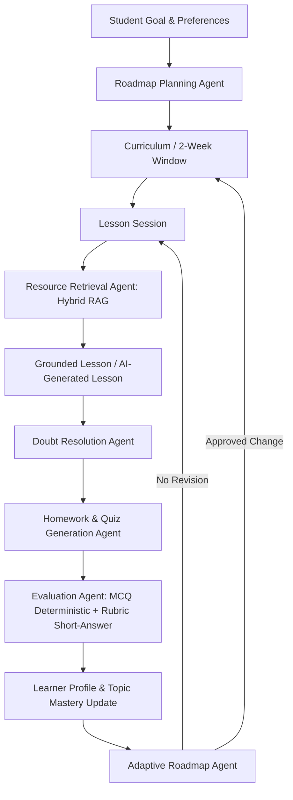
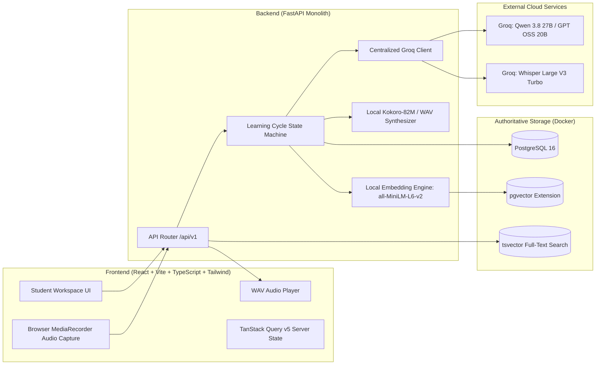
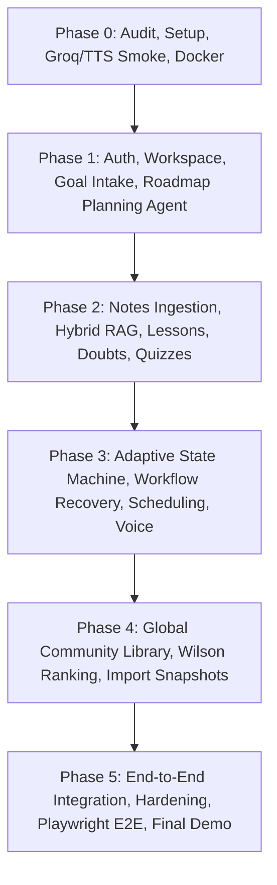

# LearnWeave AI — Architecture Specification & Phase Dependency Map

## 1. System Overview & Core Learning Cycle

LearnWeave AI is an agentic, personalized, privacy-conscious long-term learning platform. Rather than maintaining unbounded conversation histories, it operates on a structured, stateful learning cycle:

---

## 2. Component Architecture

---

## 3. Privacy, Authorization & Visibility Boundaries

1. **Private by Default**: All uploaded student notes, embeddings, lesson cycles, quiz attempts, and memories belong to the authenticated student workspace.
2. **Strict DB-Level Filtering**: Vector distance calculations and keyword searches filter by `owner_id == authenticated_user_id` before ranking.
3. **No Cross-User Leaks**: User B cannot view User A's private note chunks or quiz attempts.
4. **Community Isolation**: Public notes are explicitly published. When imported into a student's workspace, an independent snapshot copy is created with `source_note_id`. Original modifications or deletions never silently mutate student copies.
5. **No Token Fabrication**: When notes are missing, the system gracefully enters **Mode B (AI-Generated Learning)**, clearly labeled as ungrounded background material without hallucinated source citations.

---

## 4. Phase Dependency Map & Acceptance Checklist

### Phase Acceptance Criteria Checklist
- [x] **Phase 0 Acceptance**:
  - [x] Docker PostgreSQL 16 + pgvector running.
  - [x] Backend FastAPI health and readiness endpoints active.
  - [x] Centralized GroqClient operational with Qwen 3.8 27B, GPT OSS 20B fallback, and Whisper STT.
  - [x] Local Kokoro / WAV synthesis producing valid 24kHz audio.
  - [x] Alembic migration engine verified.
  - [x] Phase 0 evaluation report written (`evals/results/phase0.md`).
- [ ] **Phase 1 Acceptance**:
  - [ ] Auth & Workspace ownership.
  - [ ] Roadmap Planning Agent generating 2-week active window + placeholder modules.
  - [ ] 30 synthetic goals evaluated.
  - [ ] Schema-valid rate >= 95%, rule-pass rate >= 90%.
- [ ] **Phase 2 Acceptance**:
  - [ ] Private notes ingestion (PDF, MD, TXT) with chunking & local embeddings.
  - [ ] Hybrid search (pgvector + FTS + RRF).
  - [ ] Recall@5 >= 0.80 benchmark on 30 hand-labeled queries.
  - [ ] Grounded lesson generation & doubt resolution.
  - [ ] Deterministic MCQ & rubric short-answer scoring.
- [ ] **Phase 3 Acceptance**:
  - [ ] Resumable `cycle_runs` state machine with idempotency.
  - [ ] Adaptive roadmap agent adjusting future curriculum based on 70% threshold.
  - [ ] Voice loop (Browser audio -> Groq Whisper -> LLM answer -> Kokoro WAV -> Browser).
  - [ ] 20 scripted adaptive workflow scenarios passing 100%.
- [ ] **Phase 4 Acceptance**:
  - [ ] Community library with Wilson score lower-bound ranking (z=1.96).
  - [ ] Independent imported copies.
  - [ ] Direct API privacy scan verifying `author_id` is never exposed.
- [ ] **Phase 5 Acceptance**:
  - [ ] Complete user journey verified via automated E2E script and Playwright.
  - [ ] Zero unhandled 429 errors under rate-limiter guard.
  - [ ] Final comprehensive documentation and delivery report.
